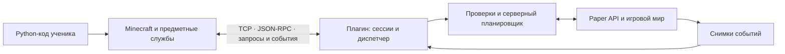

Проект библиотеки Python и серверного плагина Minecraft
====================================================

Целевая архитектура от 15 октября 2026 года. Состояние на 21 октября:
[T01](docs/reports/T01.ru.md), [T02](docs/reports/T02.ru.md),
[T03](docs/reports/T03.ru.md), [T04](docs/reports/T04.ru.md) и
[T05](docs/reports/T05.ru.md), [T06](docs/reports/T06.ru.md) и
[T07](docs/reports/T07.ru.md), [T08](docs/reports/T08.ru.md) и
[T09](docs/reports/T09.ru.md) реализованы и проверены.
Негативная приёмка технического среза остаётся T10.
Разработку определяют [план](docs/IMPLEMENTATION_PLAN.ru.md),
[зафиксированный контракт v0.1, r1](docs/contracts/V0_1_CONTRACT.ru.md) и
[план Paper-проверок](docs/PAPER_INTEGRATION_TEST_PLAN.ru.md).
Ниже описана целевая платформа. Первая версия реализует только явно выделенный
минимальный срез; будущий API ниже не означает, что он уже доступен в программе.
`minebridge` ниже — рабочее имя для примеров, а не выбранное имя пакета в PyPI.
Уточнённая основа: общий сервер Paper, каждый ученик запускает Python у себя.
Первой целевой версией принимаем Minecraft Java Edition 26.2 и Paper 26.2;
пользователь указал «1.26.2», официальный номер соответствующего релиза — 26.2.
Для сервера и сборки плагина выбираем Java/JDK 25. Конкретный build Paper
фиксируем перед реализацией, а не используем плавающую зависимость.
Ученики могут менять компьютеры и ники между занятиями. Постоянная привязка
ученика к компьютеру, локальному профилю или игровому UUID не предполагается.

1. Цель и границы
-----------------

Дать Python-программе широкий доступ к состоянию и событиям Minecraft Java Edition:
строительство, игроки, сущности, инвентари, эффекты, интерфейс, scoreboard,
мини-игры и автоматизация. Сохранить перечисленные пользователем вызовы mcpi.

Базовая платформа — обычный Paper 26.2 и плагин на Java 25.
Folia, Fabric, Forge и Bedrock не считаются автоматически
поддерживаемыми. Для них потребуются отдельные решения или адаптеры.

Библиотека не может обещать любую возможную задумку без ограничений. Произвольные
экраны, новые клавиши управления, новая клиентская логика блоков и рендеринг
выходят за возможности одного серверного плагина. Ресурс-пак может добавить
визуальные ресурсы; для произвольной клиентской логики нужен клиентский мод.

Ориентир — расширяемое API возможностей сервера, а не окончательный список
«всех методов». Новые возможности добавляются отдельными предметными модулями.

2. Общая схема
--------------



Python отвечает за удобный синтаксис, типы, преобразование старых блоков,
связь и обработку ошибок. Плагин проверяет запросы и права, разрешает селекторы,
выполняет операции в разрешённом серверном потоке и сообщает результат.

Сначала фиксируем пользовательские сценарии и API, затем сетевой контракт,
после чего реализуем библиотеку и плагин вертикальными срезами. Полностью
реализовывать одну сторону до проектирования другой не стоит.

3. Совместимость с пройденными уроками
------------------------------------

```python
from minebridge.minecraft import Minecraft
from minebridge import block

mc = Minecraft.create("192.168.0.200", 4711)
player_id = mc.getPlayerEntityId("Steve")
mc.setBlock(0, 64, 0, 4)
mc.setBlocks(0, 64, 0, 30, 94, 30, block.COBBLESTONE)
```

Импорты меняются; перечисленные вызовы и порядок аргументов сохраняются.
Используем camelCase и для новых публичных методов, чтобы не вводить второй стиль
в одном курсе. Имена служебных модулей Python остаются в нижнем регистре.

Предлагаемые сигнатуры фасада:

```python
Minecraft.create(ip="localhost", port=4711, *, token=None, player=None, pairingCode=None,
                 world=None, project=None, timeout=5.0, coordinates=None) -> Minecraft
mc.getPlayerEntityId(name: str) -> int
mc.setBlock(x, y, z, block, data=0) -> None
mc.setBlocks(x1, y1, z1, x2, y2, z2, block, data=0, *, waitTimeout=None) -> None
mc.close() -> None
```

`coordinates=None` принимает объявленный сервером профиль координат. В новом
проекте профиль по умолчанию — абсолютные координаты. Для переноса существующих
уроков доступен профиль `legacy-relative` с согласованной точкой отсчёта.
У RaspberryJuice координаты могли быть относительными к спавну: одинаковый
синтаксис сам по себе не обеспечивает одинакового места строительства.

Договорённости о поведении:

- `setBlocks` заполняет весь прямоугольный параллелепипед, включая обе границы.
  Переставленные местами углы допустимы. Область от 0 до 30 имеет длину 31 блок.
- Блочные координаты округляются вниз: `-0.2` превращается в `-1`.
  Координаты позиции игрока могут быть дробными.
- Высота мира проверяется по данным сервера. Нельзя вшивать пределы 0 и 255.
- Мир и начало координат определяются контекстом сессии. Переход игрока
  в другой мир не должен незаметно менять мир уже заданного контекста.
- Запись возвращается после завершения операции. `setBlocks` может ждать
  несколько тиков. Это уточнённая гарантия нового API, а не обещание повторить
  старое поведение отправки без подтверждения.
- Отсутствующий игрок вызывает `PlayerNotFoundError`; числовой результат
  `getPlayerEntityId` — текущий runtime ID сущности, не постоянный ID человека.
- Сетевой протокол RaspberryJuice не сохраняем. Новый пакет требует новый плагин.
  Два плагина не могут одновременно слушать один и тот же адрес и порт.

При необходимости также добавляем совместимые `mc.player.getPos/setPos`,
`mc.entity.getPos/setPos` и `mc.postToChat`, но их точный охват нужно сверить
с существующими материалами курса. Если игрок не привязан и на сервере их
несколько, `mc.player` требует явного выбора, а не выбирает первого попавшегося.

Токен при необходимости можно передать явно или читать из `MINEBRIDGE_TOKEN`.
Он определяет права подключения. Если сервер требует авторизацию, а действующего
токена или кода сопряжения нет, подключение завершается понятной ошибкой.
Параметр `player` выбирает исполнителя в рамках этих прав; знание ника само
по себе не подтверждает личность. Выбор исполнителя и авторизация — разные задачи.

`timeout` относится к подключению и ответу на отдельный короткий RPC-запрос,
включая подтверждение создания задания. Он не ограничивает всю длительность
строительства. `setBlocks` запускает задание и ожидает его отдельно;
`waitTimeout=None` означает отсутствие общего предела ожидания при живой связи.
Заданный `waitTimeout` ограничивает ожидание, но сам по себе не отменяет работу.

Для курса с меняющимися компьютерами и никами базовый выбор исполнителя —
явно указанный текущий ник в необязательном `player`, например:

```python
mc = Minecraft.create("192.168.0.200", 4711, player="CurrentNick")
mc.players.giveItem(selector.SELF, items.IRON_SWORD, 1)
```

При подключении плагин находит онлайн-игрока, проверяет права и запоминает UUID
его текущей игровой личности. `SELF` обращается к этому UUID в пределах контекста.
На следующем занятии можно указать другой ник с другого компьютера.
Вместо литерала программа может получить ник через `input`, если это удобно уроку.

Существующая форма `Minecraft.create(ip, port)` остаётся допустимой.
После неё при необходимости можно использовать уже предусмотренный
`mc.withContext(player="CurrentNick")`. Если игрок не задан ни явно, ни через
действующую привязку текущего занятия, использование `SELF` вызывает
`MissingContextError`; библиотека не выбирает игрока по IP или порядку входа.
`getPlayerEntityId` остаётся поиском ID и не меняет исполнителя неявно.

Дополнительный режим — подтверждённая привязка на текущее занятие:
игрок выполняет предлагаемую команду `/py link` в Minecraft и получает
одноразовый код; Python передаёт его как `pairingCode`. Плагин уже знает
отправителя игровой команды и связывает подключение с его текущим UUID.
Код ограничен по сроку и используется один раз. Повторные запуски Python могут
использовать выданный временный токен занятия. Долгоживущий код внутри учебного
скрипта не сохраняем; истечение/завершение занятия требует новой привязки.
Это опциональный механизм, а не обязательный дополнительный шаг каждого вызова.

Автоматически узнавать того же человека после одновременной смены компьютера
и ника невозможно без отдельного идентификатора ученика. Если понадобится
история проектов между занятиями, такой идентификатор вводится отдельно
от игровой личности и выдаётся преподавателем либо через учётную запись.

4. Блоки: старые числа и современное описание
-------------------------------------------

Входной тип `BlockInput = int | LegacyBlock | str | BlockSpec`.
Модуль `block` содержит статически объявленные типизированные константы:
исторические имена сохраняют совместимый тип, современные используют `BlockSpec`.

```python
mc.setBlock(0, 64, 0, 4)
mc.setBlock(1, 64, 0, block.COBBLESTONE)
mc.setBlock(2, 64, 0, "minecraft:cobblestone")
mc.setBlock(3, 64, 0, "minecraft:oak_stairs[facing=east,half=bottom]")
mc.setBlock(4, 64, 0, 35, 14)  # поддерживаемая пара legacy ID + data
```

`LegacyBlock(id, data=0)` хранит старые `.id` и `.data`.
Существующие константы модуля `block`, включая `COBBLESTONE`, используют этот тип.
`BlockSpec(key, states={...})` хранит современное имя и свойства, без выдуманного
числового ID. Объекты спецификаций — неизменяемые значения.

Перевод `(id, data) -> BlockSpec` выполняется по версионируемой таблице
совместимости. Для старых блоков с несколькими частями могут потребоваться
специальные операции установки; полноту таких случаев проверяем отдельно.
Неизвестные и неоднозначные значения вызывают `UnsupportedLegacyBlockError`.
Смешивание современного `BlockSpec` с ненулевым legacy `data` — ошибка аргументов.
Не заменяем неизвестные блоки воздухом и не используем номер элемента Java enum.

В протокол всегда отправляются современные ключи и свойства. Сервер проверяет
их по своей версии и реестру. Таблица старых ID — отдельный слой совместимости,
новым блокам не назначаем собственные числовые ID.

`mc.blocks.getBlock(x, y, z)` возвращает `BlockSpec`. Если добавляем совместимый
корневой `mc.getBlock`, он возвращает старый `int` только при существующем
соответствии; иначе — `UnsupportedLegacyBlockError`. Данные контейнеров,
текст таблички и другие данные блока обслуживаются отдельными методами,
поскольку имя и свойства блока их не описывают.

5. Предметные службы библиотеки
------------------------------

`Minecraft` — точка входа и владелец сессии. Он содержит службы через композицию.
Корневой `setBlock` делегирует `mc.blocks.setBlock`; второй реализации нет.
Глубокая иерархия наследования для служб не требуется.

| Свойство | Класс | Основные методы и назначение |
|---|---|---|
| `mc.blocks` | `BlocksAPI` | `getBlock`, `getBlocks`, `setBlock`, `setBlocks`, `fill`, `replace`, `getHeight`, `getSign`, `setSign` |
| `mc.worlds` | `WorldsAPI` | `list`, `get`, `getTime`, `setTime`, `setWeather`, `getGameRule`, `setGameRule`, `getSpawn`, `setSpawn` |
| `mc.players` | `PlayersAPI` | `get`, `list`, `getPos`, `teleport`, `giveItem`, `clearInventory`, `setGameMode`, `setHealth`, `setFoodLevel` |
| `mc.entities` | `EntitiesAPI` | `get`, `find`, `spawn`, `remove`, `getPos`, `teleport`, `setVelocity`, `setName`, `addTag`, `removeTag` |
| `mc.effects` | `EffectsAPI` | `add`, `remove`, `clear`, `list` для живых сущностей |
| `mc.inventories` | `InventoriesAPI` | `ofPlayer`, `ofBlock`, `createMenu`; через `InventoryRef`: `getItem`, `setItem`, `addItem`, `clear` |
| `mc.ui` | `UIAPI` | `chat`, `title`, `actionBar`, `createBossBar`, `setTabList`; дополнительные диалоги по capability |
| `mc.scoreboard` | `ScoreboardAPI` | `createBoard`, `getBoard`, `listBoards`; отдельные объекты досок, objectives и teams |
| `mc.events` | `EventsAPI` | `subscribe`, `poll`, `run`, `stop`; уведомления с типами и фильтрами |
| `mc.rules` | `RulesAPI` | `add`, `remove`, `list`; заранее зарегистрированные серверные правила |
| `mc.sounds` | `SoundsAPI` | `play`, `stop` |
| `mc.particles` | `ParticlesAPI` | `spawn` с типизированными параметрами частиц |
| `mc.structures` | `StructuresAPI` | `capture`, `place`, `list`, `delete` по разрешённым именам ресурсов |
| `mc.recipes` | `RecipesAPI` | `register`, `remove`, `list` для поддерживаемых рецептов |
| `mc.commands` | `CommandsAPI` | `run` как отдельная привилегированная возможность |
| `mc.server` | `ServerAPI` | `getInfo`, `getCapabilities`, `getLimits`, `getRegistry` |

Это карта развития API, а не обязательство реализовать всю таблицу в первом релизе.
Генерацию миров, продвинутый AI/pathfinding, display-сущности, advancement,
loot tables и взаимодействие с другими плагинами добавляем самостоятельными
модулями. Настоящие новые типы блоков/сущностей с клиентской логикой — отдельная
модовая платформа, а не ещё один метод Paper-плагина.

6. Классы значений и ссылки
--------------------------

- `Vec3(x, y, z)` — вектор; `BlockPos(x, y, z)` — целые блочные координаты.
- `Location(world, x, y, z, yaw=None, pitch=None)` — позиция с миром.
- `BlockSpec`, `LegacyBlock`, `ItemStack`, `Effect`, `Text` — описания значений.
- `ItemKey`, `EffectKey`, `EntityTypeKey`, `SoundKey`, `ParticleKey`,
  `EnchantmentKey` — различные неизменяемые типы ключей открытых реестров.
- `GameMode`, `Weather`, `DisplaySlot`, `Direction` — типы закрытых наборов
  значений, когда конкретный параметр действительно имеет конечный контракт.
- `ExecutionContext` — мир, исполнитель, позиция выполнения и профиль координат.
- `EntityRef`, `LivingEntityRef(EntityRef)`, `PlayerRef(LivingEntityRef)` —
  ссылки на сущности. Идентичность игровой сущности — UUID и идентификатор сервера;
  runtime ID хранится отдельно. Игровой UUID не отождествляем с постоянной личностью
  ученика при смене ников/аккаунтов. Ссылка не гарантирует, что сущность загружена.
- `WorldRef`, `InventoryRef`, `ScoreboardRef`, `ObjectiveRef`, `TeamRef`,
  `BossBarRef`, `JobRef`, `Subscription` — ссылки на управляемые ресурсы.
- `TargetResult`, `InventoryResult`, `JobResult` — явные результаты операций.

Наследование оправдано там, где отражает типы сущностей и семейства ошибок.
Ссылки не загружают автоматически весь объект и не являются локальными копиями
состояния сервера. Обычное чтение свойства ссылки не должно скрыто делать
сетевой запрос; чтения состояния имеют явные методы.

`ItemStack(material: ItemKey | str, amount=1, name=None, lore=None, enchantments=None,
components=None)` описывает предмет. Обычные параметры имеют стабильный API.
Расширенные компоненты и данные зависят от объявленных возможностей сервера.
Произвольный NBT не становится обязательной основой предметного API.

6а. Константы допустимых значений и подсказки IDE
----------------------------------------------

Требование: ученик выбирает известные значения после точки, как в mcpi:

```python
from minebridge import block, items, selector, effects, entities, gamemode

mc.setBlock(0, 64, 0, block.COBBLESTONE)
mc.players.giveItem(selector.ALL_PLAYERS, items.IRON_SWORD, 1)
mc.effects.add(selector.SELF, effects.SPEED, duration=30, level=2)
mc.players.setGameMode(selector.SELF, gamemode.CREATIVE)
mc.entities.spawn(entities.ZOMBIE, 10, 64, 10)
```

Последний пример задаёт сигнатуру нового `EntitiesAPI.spawn(type, x, y, z, *,
world=None) -> EntityRef`. Совместимые методы mcpi, если понадобятся,
остаются отдельными адаптерами со своим прежним порядком аргументов.

Технически это модули констант и перечисления, а не отдельный подкласс для
каждого значения. Железный и алмазный мечи имеют один тип `ItemKey`, но разные
ключи. Наследование не требуется для появления имён в автодополнении.

| Модуль | Примеры | Тип значения |
|---|---|---|
| `block` | `COBBLESTONE`, `OAK_STAIRS` | `LegacyBlock` или `BlockSpec` |
| `items` | `IRON_SWORD`, `DIAMOND`, `BREAD` | `ItemKey` |
| `selector` | `ALL_PLAYERS`, `RANDOM_PLAYER`, `NEAREST_PLAYER`, `SELF`, `ALL_ENTITIES` | `Selector` |
| `effects` | `SPEED`, `JUMP_BOOST`, `NIGHT_VISION` | `EffectKey` |
| `entities` | `ZOMBIE`, `COW`, `ARMOR_STAND` | `EntityTypeKey` |
| `gamemode` | `SURVIVAL`, `CREATIVE`, `ADVENTURE`, `SPECTATOR` | `GameMode` |
| `weather` | `CLEAR`, `RAIN`, `THUNDER` | `Weather` |
| `display_slots` | `SIDEBAR`, `BELOW_NAME`, `PLAYER_LIST` | `DisplaySlot` |
| `direction` | `NORTH`, `SOUTH`, `EAST`, `WEST`, `UP`, `DOWN` | `Direction` |
| `sounds` | `ENTITY_PLAYER_LEVELUP` | `SoundKey` |
| `particles` | `FLAME` | `ParticleKey` |
| `enchantments` | `SHARPNESS` | `EnchantmentKey` |
| `events` | `BLOCK_BREAK`, `PLAYER_JOIN` | Типизированное описание события |

Описание типа предмета отделено от количества и свойств конкретного экземпляра:

```python
from minebridge.models import ItemStack

prize = ItemStack(items.IRON_SWORD, amount=1, name="Меч строителя")
mc.players.giveItem(selector.SELF, prize)
```

Константы неизменяемы: создание `prize` не меняет `items.IRON_SWORD`.
Модули описаний не заменяют службы: `effects.SPEED` задаёт значение,
а `mc.effects.add(...)` выполняет действие на сервере.

Для открытых реестров используем отдельные доменные объекты с полем `key`.
Например, сгенерированные объявления в соответствующих модулях:

```python
IRON_SWORD: Final[ItemKey] = ItemKey("minecraft:iron_sword")
SPEED: Final[EffectKey] = EffectKey("minecraft:speed")
```

`ItemKey` и `EffectKey` не наследуются от `str`: тогда анализатор типов может
обнаружить передачу предмета вместо эффекта, даже если метод также принимает
строковый идентификатор. Строки остаются для поддерживаемых сервером ключей,
которых ещё нет среди констант установленной библиотеки. Сам по себе новый
ключ не добавляет серверу новый предмет или эффект.

```python
ItemInput = ItemKey | ItemStack | str
EffectInput = EffectKey | str
OverflowMode = Literal["return", "drop"]

# Типизированные сигнатуры методов соответствующих служб:
giveItem(targets: TargetSpec, item: ItemInput, amount: int | None = None,
         *, overflow: OverflowMode = "return") -> InventoryResult
add(targets: TargetSpec, effect: EffectInput, *, duration: float,
    level: int = 1, particles: bool = True) -> TargetResult
setGameMode(targets: TargetSpec, mode: GameMode) -> TargetResult
```

Для закрытых наборов используем `Enum` и/или `Literal`. Если поддерживаем
строковую форму такого параметра, перечисляем разрешённые строки через `Literal`.
Тип `Literal[...] | str` не ограничивает значения и не служит надёжной основой
подсказок. Сервер продолжает проверять значения: аннотации Python сами по себе
не являются проверкой времени выполнения.

Константы селекторов хранят выражения выбора, а не списки игроков:
`ALL_PLAYERS` означает `@a`, `RANDOM_PLAYER` — `@r`, `NEAREST_PLAYER` — `@p`,
`SELF` — `@s`, `ALL_ENTITIES` — `@e`. Они разрешаются на сервере при каждой
операции. Правила контекста и прав сохраняются. Для сложных условий остаются
vanilla-строки и отдельный типизированный конструктор селекторов.

Подсказки обеспечиваются статическим описанием установленного пакета:

- Константы присутствуют в настоящих `.py` с аннотациями `Final[DomainType]`;
  при необходимости используются согласованные `.pyi`.
- В пакет включается `py.typed`; публичные модули явно экспортируются.
- Методы имеют точные сигнатуры, типы результатов и docstrings. Описание
  константы указывает её ключ, смысл и при необходимости требование контекста.
- Каталоги генерируются при выпуске библиотеки из проверенного снимка целевой
  версии. Не создаём тысячи имён вручную или только после подключения к серверу.
- Одних динамических `__getattr__`, `setattr` и `__dir__` недостаточно для
  надёжного статического автодополнения: нужны сгенерированные объявления.
- Варианты после `items.` и `selector.` доступны без запущенного Minecraft.
  Проверяем автодополнение, сигнатуры и наведение в VS Code/Pylance и PyCharm.
  Показ списка в пустом аргументе зависит от редактора; основной пользовательский
  путь — ввод имени модуля и точки. Наличие константы не заменяет проверку
  возможностей подключённого сервера.

Если различаются сами параметры, полезны специализированные семейства типов:
например, описания состояний лестницы и бревна. Для них можно генерировать
конструкторы с конкретными именованными аргументами. Общий `BlockSpec` и строковая
форма сохраняются. Класс для каждого отдельного предмета или блока не нужен.

7. Селекторы и контекст выполнения
---------------------------------

```python
mc.players.giveItem("Steve", "minecraft:diamond", 3)
mc.players.giveItem("@a", "minecraft:bread", 8)
mc.players.giveItem("@r", "minecraft:golden_apple", 1)
mc.effects.add("@a", "minecraft:speed", duration=30, level=2)
mc.ui.title("@a", "Начинаем!", subtitle="Постройте мост")

me = mc.withContext(player="Steve", world="world")
me.players.giveItem("@s", "minecraft:stick", 1)
me.ui.actionBar("@p", "Ты ближе всех")
```

Предлагаемые сигнатуры:

```python
mc.players.get(name_or_uuid) -> PlayerRef
mc.players.list(targets="@a") -> list[PlayerRef]
mc.players.giveItem(targets: TargetSpec, item: ItemInput, amount=None, *, overflow="return") -> InventoryResult
mc.players.teleport(targets, x, y, z, *, world=None) -> TargetResult
mc.effects.add(targets: TargetSpec, effect: EffectInput, *, duration, level=1, particles=True) -> TargetResult
mc.ui.title(targets, title, *, subtitle="", fadeIn=0.5, stay=3, fadeOut=0.5) -> TargetResult
mc.withContext(*, player=None, world=None, origin=None) -> Minecraft
```

`amount=None` использует количество из `ItemStack`; у строкового имени предмета
это 1. Переданный `amount` явно заменяет количество из `ItemStack`.
`duration` и интервалы UI измеряются в игровых секундах и переводятся в тики
при нормальных 20 TPS. `level=1` означает первый уровень эффекта; сервер сам
преобразует его в используемый API amplifier. Лаги удлиняют реальное время.

`TargetSpec` принимает имя игрока, UUID, `EntityRef`, `Selector` или явный список
ссылок. Строки `@...` считаются vanilla-селекторами. Числовой runtime ID допустим
только в совместимых методах `mc.entity`, чтобы не путать его с UUID и типом моба.

Договорённости:

- `@s` требует связанного исполнителя. Python-подключение само не игрок.
- `@p`, расстояния и пространственные фильтры требуют мира и точки отсчёта.
  При контексте игрока без `origin` берётся текущая позиция этого игрока
  в момент операции. Если игрок сменил явно закреплённый мир — ошибка контекста.
- `withContext` возвращает новый фасад поверх той же сессии и не меняет исходный.
  Выбор исполнителя дополнительно ограничен правами сессии.
- Селектор разрешается сервером один раз на операцию, непосредственно перед ней.
  `@r` не должен заново выбирать игрока для проверки прав и затем для исполнения.
- Грамматика следует выбранной версии Minecraft; используем серверный механизм
  разрешения селекторов с явным контекстом, а не пишем несовместимый парсер.
- Операции игроков требуют игроков, эффекты — живых сущностей. Несовместимый тип
  вызывает ошибку до изменений. Функциональность селектора не даёт ему прав.
- `@a` сохраняет vanilla-значение «все игроки». Если среди выбранных целей есть
  запрещённая для сессии, операция завершается `PermissionDeniedError` до любых
  изменений. Молча исключать таких игроков из выбора нельзя. Преподаватель может
  разрешить общие действия для конкретного упражнения; общий сервер сам по себе
  не означает обязательное ограничение всех команд только собственным игроком.
- Неверный селектор — ошибка. Корректный пустой групповой выбор — результат
  `matched=0`. Запрос конкретного отсутствующего игрока — `PlayerNotFoundError`.
- До изменения проверяется весь список целей. Изменения, произошедшие уже
  во время исполнения, отражаются в результате по каждой цели; общей
  транзакционности для нескольких игроков не обещаем.

`TargetResult` содержит `matched`, `applied` и результаты по UUID с причинами
пропусков/ошибок. `InventoryResult` также хранит выданное количество и остатки
для каждого получателя. При полном инвентаре предметы по умолчанию остаются
в результате, а не исчезают. Выброс на землю — явный `overflow="drop"`.

8. Scoreboard как отдельная модель
---------------------------------

```python
board = mc.scoreboard.createBoard("lesson")
points = board.createObjective("points", criteria="dummy", displayName="Очки")
points.setScore("@a", 0)
points.addScore("Steve", 10)
points.display("sidebar")
board.show("@a")

team = board.createTeam("builders", displayName="Строители")
team.add("Steve")
team.setFriendlyFire(False)
```

`ScoreboardRef`: `createObjective`, `getObjective`, `createTeam`, `getTeam`,
`show`, `hide`, `delete`.

`ObjectiveRef`: `setScore(targets, value)`, `addScore(targets, delta)`,
`getScore(player)`, `getScores(targets)`, `resetScore(targets)`,
`setEntryScore(label, value)`, `display(slot)`, `delete`.

`TeamRef`: `add`, `remove`, `setPrefix`, `setSuffix`, `setColor`,
`setFriendlyFire`, `setOption`, `delete`.

Игровые цели и произвольные текстовые строки различаются явно:
`setScore("Steve", 10)` работает с игроком, `setEntryScore("Волна", 3)` —
с текстовой записью. `addScore` выполняется сервером одной операцией,
без гонки между отдельными клиентскими чтением и записью.
Запись допускается только для изменяемых критериев, например `dummy`.

В первом релизе операции с игровыми целями требуют онлайн-игрока, в том числе
при передаче `PlayerRef`; офлайн-счёт — отдельная будущая возможность.
Плагин преобразует UUID игрока в реального серверного score holder с текущим
именем, а не использует строку UUID как произвольную запись. Доска хранит
соответствие UUID и holder. Коллизия текстовой записи с именем игрока вызывает
`ScoreEntryCollisionError` до изменения, независимо от того, какой тип записи
был зарегистрирован первым. Для управляемых `dummy`-целей при смене имени
предусматривается перенос значения после проверки коллизий. Для автоматических
критериев действует серверная семантика, перенос значений не обещается.

Данные доски, отображаемая цель и зрители — разные понятия. По умолчанию доска
изолирована в пространстве проекта. Vanilla-команды scoreboard обычно работают
с основной доской сервера; это отдельный явно выбранный режим совместимости.
У игрока есть ограничения на одновременно отображаемый scoreboard/слоты.
Для конфликтов с другими плагинами задаём политику владения и восстановления,
а не обещаем бесконечно много независимых sidebar одновременно.

Логические имена `lesson`, `points`, `builders` преобразуются в имена ресурсов
внутри области проекта/сессии. Поэтому одинаковые примеры двух учеников не
изменяют одну и ту же доску. Конфликт отображения для одного зрителя отдельный:
показывать доску или заменять занятой слот можно только с соответствующим правом
и явной политикой замены. Одно лишь уникальное имя проблему отображения не решает.

9. События, Python-обработчики и серверные правила
----------------------------------------------

```python
def on_break(event):
    mc.ui.actionBar(event.player, "Ты сломал блок")

subscription = mc.events.subscribe("block.break", on_break)
mc.events.run()
```

События: вход/выход игрока, чат, взаимодействие, установка/разрушение блока,
смерть, урон, перемещение с фильтрацией, изменение мира, клики по меню,
попадания снарядов. Для каждого вида — документированная структура данных.
Где событие допускает вмешательство других плагинов, указываем фазу наблюдения
и финальный известный статус отмены. Уведомление не обещает проверку всех
возможных последующих физических изменений мира.

В первой версии `subscribe` регистрирует подписку, а `events.run()` выполняет
callbacks последовательно в вызывающем потоке. Сетевой поток независимо
читает ответы и помещает события в ограниченную очередь. Поэтому callback
может безопасно вызывать обычный синхронный метод библиотеки.
`poll(timeout=...)` — альтернативный способ читать события без callbacks.
Фоновый и asyncio-интерфейсы можно добавить позже с явно заданной моделью.

Сетевой callback не отменяет исходное событие синхронно. Плагин не ждёт
ответа Python внутри игрового тика. Для запрета разрушения/урона и других
немедленных решений служат заранее переданные декларативные правила:

```python
rule = mc.rules.add(
    event="block.break",
    region={"world": "world", "min": [0, 60, 0], "max": [30, 90, 30]},
    action="cancel",
)
```

Правило исполняется в плагине только для поддерживаемых условий и отменяемых
событий. Произвольную Python-функцию сериализовать и отправить на сервер нельзя.
Права на правило, приоритет и поведение рядом с другими плагинами определяются
сервером. Уведомление об отменённом действии может приходить отдельно.

Фильтрация выполняется до отправки. Уведомления содержат `subscriptionId`,
номер последовательности и снимок данных, а не живую Java-ссылку.
Очереди ограничены; пропуск событий отражается явным уведомлением.
Непрерывность потока через перезапуск сервера не обещаем.

10. Сеть и ошибки
----------------

Первый транспорт: постоянное TCP-соединение, JSON-RPC 2.0, UTF-8,
одно JSON-сообщение на строку (NDJSON). Переносы строк внутри строковых значений
экранируются JSON-сериализатором. Ограничиваем размер кадра, глубину JSON,
число ожидающих запросов и длину очередей. WebSocket — возможный отдельный
адаптер для браузеров, не обязательная зависимость первой версии.

Пример сообщения после handshake:

```json
{"jsonrpc":"2.0","id":42,"method":"blocks.set","params":{"world":"world","position":[0,64,0],"block":{"key":"minecraft:cobblestone","states":{}}}}
```

```json
{"jsonrpc":"2.0","id":42,"result":{"applied":true}}
```

`system.hello` согласует major/minor протокола, авторизацию, версии пакета
и плагина, версию сервера, возможности, разрешённые миры, профиль координат,
лимиты и ревизию реестров. Несовместимый major — отказ при подключении.
Новые необязательные возможности добавляются через capability negotiation.
Версия протокола не равна версии Minecraft или Python-пакета.

Все мутации подтверждаются ответом. События и изменения состояния заданий
передаются отдельными уведомлениями. Ответы сопоставляются с запросами по ID.
Внутри сессии задаётся порядок мутаций; последующее чтение видит предыдущую
завершённую запись. Долгое задание имеет отдельную семантику ожидания.

Общая база ошибок `MinecraftError`; отдельные типы: `ConnectionError`,
`AuthenticationError`, `PermissionDeniedError`, `ProtocolVersionError`,
`UnsupportedFeatureError`, `InvalidBlockError`, `InvalidSelectorError`,
`MissingContextError`, `PlayerNotFoundError`, `EntityNotFoundError`,
`LimitExceededError`, `OperationTimeoutError`.

На проводе — стандартная JSON-RPC ошибка с числовым кодом и `data`, где есть
стабильный машинный `code`, понятное сообщение и детали. Не пересылаем Java
stacktrace как основной ответ ученику; request ID помогает найти его в журнале.
Пакет содержит type hints, статически объявленные константы, docstrings
и маркер `py.typed`, чтобы IDE показывала методы, аргументы и варианты значений.

Тайм-аут означает неизвестный результат: операция могла уже выполниться.
Не повторяем автоматически выдачу предмета, спавн и увеличение счёта.
Для управляемых повторов предусматриваем idempotency key и ограниченный журнал
результатов с явным сроком хранения. Гарантии после перезапуска без устойчивого
журнала отдельно не обещаем.

11. Массовые операции
--------------------

Корневой `setBlocks` — синхронный совместимый вызов. Современный `fill`
возвращает управляемое задание:

```python
job = mc.blocks.fill(0, 64, 0, 100, 100, 100, "minecraft:stone")
job.wait()
# job.getProgress(), job.cancel(), job.getResult()
```

В протокол уходит описание области, не миллион отдельных запросов.
Перед началом проверяем весь объём, границы, права и поддерживаемый режим
физики. Чанки загружаются/удерживаются в пределах согласованного лимита.
Работу делим по тикам с бюджетом времени и объёма; распределяем ресурс сначала
между учениками, затем между проектами и сессиями одного ученика. Открытие
нескольких подключений не увеличивает общий бюджет ученика. Учитываем также
число удерживаемых чанков, сущностей и размер очередей.

Для пересекающихся заданий строительства предусматриваем временное резервирование
области: конфликтующая запись через наш API получает `RegionBusyError`.
Это координация запросов плагина, а не транзакционная блокировка всего мира:
игроки, физика и другие плагины могут изменять блоки согласно правилам сервера.

`JobResult` содержит состояние, обработанный объём, число непосредственных
изменений и ошибки. Физические последствия могут продолжиться после
завершения установки; они не входят в обещание числа изменённых блоков.
Флаги физики и соседних обновлений имеют серверные ограничения и документируются
по версии. Отключение одного флага не означает отключения всей игровой логики.

Отмена оставляет уже построенную часть. Undo — отдельная ограниченная история
снимков, а не обещание транзакции; данные контейнеров и конфликты с последующими
изменениями требуют отдельной политики. Обычный batch также не транзакция.

12. Устройство плагина
---------------------

| Компонент | Ответственность |
|---|---|
| `BridgePlugin` | Жизненный цикл, конфигурация и регистрация служб |
| `TcpTransport` / `JsonRpcCodec` | Сеть, кадры и сериализация вне игрового потока |
| `SessionManager` | Авторизация, профили, контексты, проекты и очистка ресурсов |
| `RequestRouter` | Сопоставление метода протокола с обработчиком |
| `PolicyService` | Проверка операций, игроков, миров, регионов и квот |
| `TargetResolver` | Серверные селекторы и однократное разрешение целей |
| `GameExecutor` | Вызовы Paper API в подходящем серверном потоке |
| `BlockService`, `PlayerService` и другие | Предметная логика операций |
| `JobManager` | Бюджеты ученика на тик, очередь, резервирование областей, прогресс и отмена |
| `EventHub` / `RuleEngine` | Уведомления и немедленные серверные правила |
| `RegistryService` | Реестры, имена типов и доступные возможности |
| `ResourceStore` | Владелец и срок жизни досок, меню, правил и других ресурсов |

Чтение и изменение игрового состояния выполняются через серверный executor;
сеть, файловые операции и ожидание клиента не блокируют игровой поток.
События, возникающие асинхронно, обрабатываются с учётом контракта конкретного
Paper API, без передачи живых игровых объектов сетевому потоку.

Основа — публичный Paper API. Версионно зависимые компоненты и неизбежный
доступ к внутренностям изолируются адаптерами; они не пронизывают всё приложение.
Java API расширений плагина позволяет позднее добавлять обработчики и capabilities
без переписывания базового транспорта и без доступа Python к произвольному Java.

У каждой сессии есть профиль доступа. На общем сервере доступны ограничения
по собственному игроку, миру и региону; у преподавателя — более широкий профиль.
Изменение времени, погоды и gamerules, операции со всеми игроками и замена чужого
scoreboard — явно назначаемые права, поскольку их последствия общие.
IP не заменяет идентичность ученика. Селекторы проходят те же проверки, что
одиночные цели. `commands.run` — отдельное право с ограниченным исполнителем;
обычный API не должен выполнять всё через административные команды.
Результат произвольной команды не обещает универсальный структурированный вывод.
За пределами доверенной локальной сети используется защищённый транспорт.

Временные ресурсы по умолчанию принадлежат сессии и удаляются после её закрытия
или grace period. Сохранённые ресурсы принадлежат проекту и переживают переподключение.
Доски, правила, подписки и задания имеют документированные сроки жизни.
Долгое задание по умолчанию отменяется при окончательном закрытии сессии;
уже выполненные изменения сохраняются. Явно сохранённое задание — отдельный режим.
Разрыв Python не откатывает построенный мир, выданные предметы и счёт.

Различаем три идентификатора: `principalId` — участник с заданными правами,
`projectId` — стабильный проект, `sessionId` — конкретное подключение.
В базовом учебном режиме `principalId` действует в пределах занятия;
постоянная личность ученика между занятиями — отдельная опциональная учётная запись.
Имена ресурсов включают соответствующую область владения. По умолчанию
`createBoard("lesson")` создаёт временную доску запуска. Постоянный ресурс
требует явного проектного scope; повторный запуск получает его через `getBoard`,
а не создаёт новый и не сбрасывает существующие данные незаметно.
Если `project` не указан, используется `default` внутри пространства участника;
проекты разных участников не объединяются. Сохранённый проект не связывается
автоматически с новым ником или другим компьютером: для этого нужен постоянный
идентификатор ученика или явная передача доступа к проекту.

13. Репозиторий и источники контракта
-----------------------------------

```text
python/                  Python-пакет и pyproject.toml
plugin/                  Java-плагин и Gradle
protocol/                Операции, схемы сообщений и коды ошибок
compat/                  Таблица старых блоков и профили совместимости
catalogs/                Данные целевых версий и генерация типизированных констант
examples/                Примеры уроков и мини-игр
docs/                    Справочник API и матрица версий
integration/             Сквозные проверки на настоящем Paper
```

Для публичной операции контракт фиксирует: параметры, тип результата,
возможные ошибки, единицы измерения, capability, права, синхронность/задание,
поведение при отсутствии целей и после разрыва связи. Схемы и DTO генерируются
или проверяются из одного источника. Предметную логику не генерируем слепо
из всего Bukkit API: его объекты и потоки нельзя просто перенести по сети.

14. Порядок реализации и проверяемый результат
--------------------------------------------

Следующие пункты — общий roadmap. Для первой реализации применяется более
подробная последовательность T00–T10 из плана; player/SELF, setBlocks и прочие
области не становятся скрытыми зависимостями одиночной записи блока.

1. Для Paper 26.2/Java 25 зафиксировать конкретную сборку, профиль координат
   и список старых уроков. Сразу включить независимые сессии двух учеников.
   Выписать 8–12 реальных сценариев: строительство, телепорт, награда случайному
   игроку, массовый эффект, титр, счёт, реакция на действие, запрет разрушения.
2. Сделать минимальный вертикальный срез: handshake → Python `setBlock`
   → плагин → Paper → подтверждение. Сразу проверить числовой ID и константу.
3. Добавить `setBlocks` с заданиями и координаты/ID игроков. Прогнать старые
   примеры с изменёнными импортами и согласованным профилем координат.
4. Реализовать новые требования: селекторы, предметы, эффекты, UI и scoreboard.
   На выходе — небольшой игровой сценарий, использующий их вместе.
5. Реализовать поток событий и серверные правила; расширить проверки нескольких
   учеников. Проверить разрыв Python, переполнение очередей, конфликт прав,
   одинаковые имена ресурсов и несколько подключений одного ученика.
6. Расширять предметные модули по конкретным проектам учеников и преподавателя.
   Добавлять новые поддерживаемые версии только после сквозной проверки.

Нужны контрактные проверки кодека, ошибок, совместимости ID и семантики селекторов;
сквозные — на настоящем сервере. Особые сценарии: отрицательные координаты,
переставленные углы, несколько миров, полный инвентарь, выход выбранного игрока,
два одновременных увеличения счёта, callback с сетевым вызовом, тайм-аут после
фактического выполнения и две параллельные большие стройки. Для производительности
измеряем длительность тиков и отзывчивость, а не только скорость заполнения.

15. Что пока не закреплено
-------------------------

- Конкретный build Paper 26.2 для фиксации зависимости и сквозных проверок.
- Абсолютные или относительные координаты в существующем курсе.
- Дополнительные методы mcpi, которые уже используются в учебных материалах.
- Окончательное название и минимальная версия Python по компьютерам учеников.
- Размер группы и условия сервера, чтобы измерить и подобрать бюджеты нагрузки.
- Политика авторизации учебного сервера и необходимость подтверждённой привязки
  одноразовым кодом; явный выбор текущего ника уже предусмотрен.
- Нужна ли постоянная учётная запись ученика для истории проектов между занятиями.
- Правила общих действий в учебных проектах.

Эти уточнения не мешают принять композицию служб, слой совместимости,
структурированный протокол и разделение событий и немедленных правил.

Фактические основания проверены по первичным источникам:

- Статус upstream RaspberryJuice и его профиль координат: [репозиторий проекта](https://github.com/zhuowei/RaspberryJuice).
- Официальное обозначение версии: [Minecraft Java Edition 26.2](https://www.minecraft.net/en-us/article/minecraft-java-edition-26-2).
- Целевая версия API: [Paper 26.2](https://jd.papermc.io/paper/26.2/index.html).
- Современное описание блока: [Server.createBlockData](https://jd.papermc.io/paper/26.2/org/bukkit/Server.html#createBlockData(java.lang.String)).
- Vanilla-селекторы и контекст отправителя: [Server.selectEntities](https://jd.papermc.io/paper/26.2/org/bukkit/Server.html#selectEntities(org.bukkit.command.CommandSender,java.lang.String)).
- Ограничения потоков: [Paper scheduling](https://docs.papermc.io/paper/dev/scheduler/).
- Текстовые компоненты: [Paper Component API](https://docs.papermc.io/paper/dev/component-api/introduction/).
- Доски и цели: [Scoreboard API](https://jd.papermc.io/paper/26.2/org/bukkit/scoreboard/Scoreboard.html).
- Соответствие Paper и Java: [требования к запуску](https://docs.papermc.io/paper/getting-started/).
- Ограничение зависимости от внутренних классов: [Minecraft internals](https://docs.papermc.io/paper/dev/internals/).
- Поставка аннотаций и `py.typed`: [Typing Python Libraries](https://typing.python.org/en/latest/guides/libraries.html).
- Закрытые варианты параметров: [Literal types](https://typing.python.org/en/latest/spec/literal.html).

Названия классов и методов `minebridge` в этом документе — предлагаемый
собственный API. Поддержку других версий сервера добавляем после отдельной проверки.
