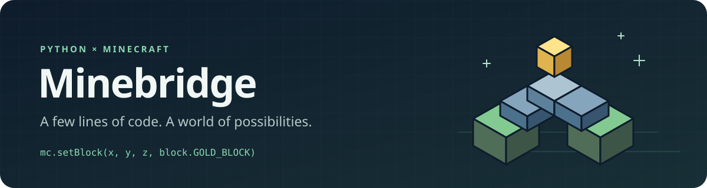

<p align="center">
  
</p>

<p align="center">
  <strong>Стройте миры, реагируйте на игроков и создавайте свои игры в Minecraft на Python.</strong><br>
  <a href="https://github.com/ilyak163rus/minebridge/releases/tag/v0.3.1">Скачать</a> ·
  <a href="docs/QUICKSTART.ru.md">Быстрый старт</a> ·
  <a href="docs/README.md">Документация</a> ·
  <a href="examples/README.md">Примеры</a> ·
  <a href="README.md">English</a>
</p>

Minebridge — типизированная Python-библиотека и плагин для **Minecraft Java Edition на Paper**. Пишите обычные Python-программы для уроков, строительства, чат-ботов и многопользовательских мини-игр. Мод на игровой клиент устанавливать не нужно.

```python
from minebridge import Minecraft, block

with Minecraft.create("localhost", 4711) as mc:
    mc.setBlocks(0, 79, 0, 10, 79, 10, block.STONE_BRICKS)
    for step in range(10):
        mc.setBlock(step, 80 + step, 5, block.GOLD_BLOCK)
    mc.postToChat("Лестница в небо готова!")
```

Координаты абсолютные. Пример строит площадку и лестницу в основном Overworld — выберите свободное место.

## Возможности

- **Блоки:** установка и чтение областей, современные состояния, автоматическая загрузка чанков.
- **Игроки:** селекторы, телепортация, режим игры, здоровье и сытость.
- **Предметы и эффекты:** выдача наград, эффекты, каталоги с подсказками в IDE.
- **Сущности:** мобы, предметы, снаряды и молнии с нужными параметрами создания.
- **Инвентари:** чтение и замена конкретных слотов игроков и сундуков.
- **События:** чат, блоки, удары, урон, выстрелы, попадания, лава, вход и выход игроков.
- **Мир:** время, погода и игровые правила.

Знакомы с `mcpi`? Привычные `Minecraft.create(ip, port)`, `setBlock`, `setBlocks`, поддерживаемые числовые ID и `block.COBBLESTONE` сохранены. Импорты меняются на `minebridge`; полная совместимость с mcpi не заявляется.

## Установка за три шага

Нужны **Python 3.11+**, **Paper 26.2** и **Java 25**. Проверенная сборка — **26.2 build 133**. Другие версии Minecraft пока не поддерживаются. Проект находится на ранней стадии; до 1.0 API может меняться.

1. Скачайте [minebridge-paper-0.3.1.jar](https://github.com/ilyak163rus/minebridge/releases/download/v0.3.1/minebridge-paper-0.3.1.jar), положите в `plugins/` остановленного сервера и запустите его. По умолчанию плагин слушает `127.0.0.1:4711`.
2. Установите библиотеку в своё окружение Python:

   ```shell
   python -m pip install "https://github.com/ilyak163rus/minebridge/releases/download/v0.3.1/minebridge-0.3.1-py3-none-any.whl"
   ```

3. Запустите пример выше. Войдите на этот сервер в Minecraft, чтобы увидеть постройку.

Локальный запуск не требует токена или имени мира. Для Python на другом компьютере настройте адрес в конфиге по [инструкции для локальной сети](docs/QUICKSTART.ru.md). Если уже установлен RaspberryJuice, выделите Minebridge отдельный порт, например `4712`, и укажите его в Python.

У Python-пакета нет зависимостей времени выполнения. Обновляйте библиотеку и плагин вместе. Готовые файлы доступны в GitHub Releases; в PyPI пакет пока не опубликован.

## Награда за сообщение в чате

```python
from minebridge import Minecraft, events, items
from minebridge.models import ChatEvent

with Minecraft.create("localhost", 4711) as mc:
    def on_chat(event: ChatEvent) -> None:
        if event.message == "!reward":
            print(mc.players.giveItem(event.player, items.EMERALD, 3))
        elif event.message == "!stop":
            mc.events.stop()

    subscription = mc.events.subscribe(events.CHAT_MESSAGE, on_chat)
    try:
        mc.events.run()
    finally:
        subscription.unsubscribe()
```

`!reward` выдаёт автору сообщения три изумруда; результат содержит остаток, если предметы не поместились. `!stop` завершает цикл. Обработчики работают в потоке `events.run()` и могут вызывать методы библиотеки.

## Дальше

- [Установка и устранение проблем](docs/QUICKSTART.ru.md).
- [Документация](docs/README.md), [единый справочник API на английском](docs/API.md) и [примеры программ](examples/README.md).
- [История изменений](CHANGELOG.md), [ошибки и предложения](https://github.com/ilyak163rus/minebridge/issues/new/choose), [участие в разработке](CONTRIBUTING.md).

Если проект пригодился, поставьте звезду и поделитесь своей постройкой или игрой — так о Minebridge узнают другие.

Лицензия — [MIT](LICENSE). [Компоненты третьих сторон](THIRD_PARTY_NOTICES.md).

Minebridge — независимый проект, не официальный продукт Mojang или Microsoft.
